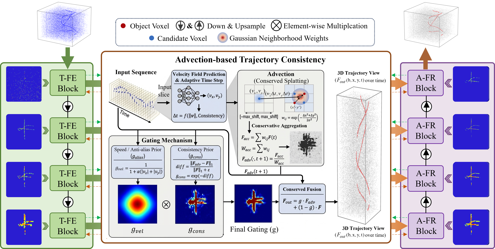
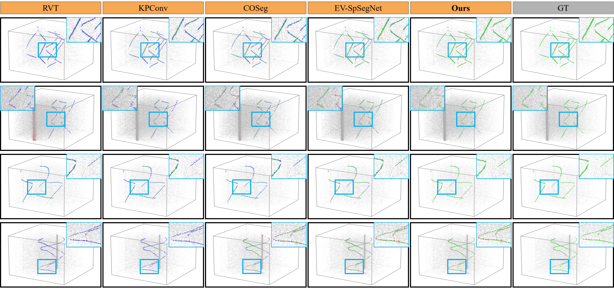
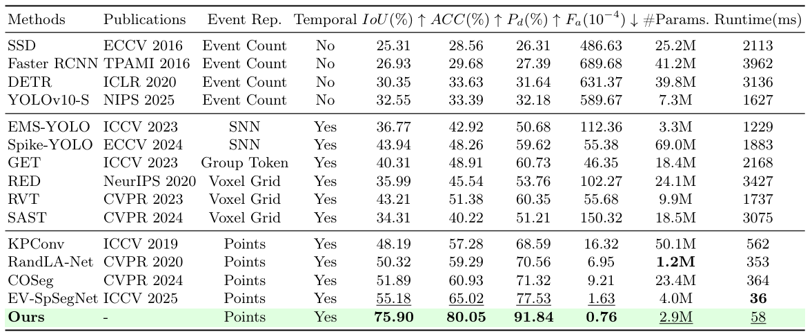

# PACT: Advection-Consistent Modeling for Event-based Small Object Detection

[](https://eccv.ecva.net/virtual/2026/poster/5799) [](https://arxiv.org/pdf/2606.22378)
> **Following the Flow: Advection-Consistent Modeling for Event-based Small Object Detection**  
> Wen Guo, Fulong Cai, Wuzhou Quan

This repository contains the official implementation of the paper "**Following the Flow: Advection-Consistent Modeling for Event-based Small Object Detection**".
We propose **PACT**, a physics-guided framework for event-based small object detection. It models event evolution as a motion-driven transport process and improves temporal coherence by propagating features along estimated velocity fields. This design helps preserve weak target responses and suppresses background noise during temporal evolution.

If our work is helpful to you, please cite it as follows:

```
@misc{guo2026followingflowadvectionconsistentmodeling,
      title={Following the Flow: Advection-Consistent Modeling for Event-based Small Object Detection}, 
      author={Wen Guo and Fulong Cai and Wuzhou Quan},
      year={2026},
      eprint={2606.22378},
      archivePrefix={arXiv},
      primaryClass={cs.CV},
      url={https://arxiv.org/abs/2606.22378}, 
}
```
**_Thanks for your attention!_**

## 🌟 Abstract

Event cameras enable high-frequency visual perception with microsecond latency, which makes them well suited for dynamic scenes. However, event-based small object detection is still difficult because event measurements are sparse and asynchronous, while target responses are weak and easily corrupted by noise. Limited spatial support further breaks temporal continuity, which leads to fragmented and unstable predictions. To address this problem, we propose a physics-guided advection-consistent modeling framework, termed **PACT**, which formulates event evolution as a motion-driven feature transport process. Instead of depending only on local spatio-temporal aggregation, PACT propagates features along estimated velocity fields and enforces trajectory-level consistency through advection constraints. This design preserves weak event responses over time and reduces their degradation under complex background interference. Technically, PACT combines motion-aware feature extraction with a differentiable advection-based transport operator, enabling coherent motion representation and effective noise suppression during temporal evolution. Extensive experiments on benchmark event-based datasets show that PACT consistently outperforms previous methods, achieving improvements of **20.72% in IoU** and **15.03% in accuracy** while maintaining comparable computational efficiency.

<p align="center">
      
      
</p>

<p align="center">

</p>

## Dataset

PACT is evaluated on the **EV-UAV** dataset.

EV-UAV is a benchmark designed for event-based UAV small object detection. It contains challenging scenes with complex backgrounds and adverse lighting conditions, which makes it suitable for evaluating temporal consistency and noise robustness in event-based perception.

Please organize the dataset in the following structure:

```text
EV-UAV/
├── train/
│   ├── train_000.npz
│   ├── train_001.npz
│   └── ...
├── val/
│   ├── val_000.npz
│   ├── val_001.npz
│   └── ...
└── test/
    ├── test_000.npz
    ├── test_001.npz
    └── ...
```

Each sample is stored in `.npz` format. The exact data definition follows the official EV-UAV release. In general, each file may include fields such as:

- `ev`: raw event stream
- `evs_norm`: normalized event representation
- `ev_loc`: event coordinates in point cloud space

PACT follows the original EV-UAV data format, for detailed dataset description, annotations, and download links, please refer to the official [EV-UAV](https://github.com/ChenYichen9527/EV-UAV) repository.

## Installation

Python dependencies are managed by [uv](https://docs.astral.sh/uv/), with
Python 3.13 selected by `.python-version`. This environment uses PyTorch 2.13
and spconv built for CUDA 12.6, following the EV-UAV project environment.
Training and inference require Linux and an NVIDIA GPU.

### 1) Install dependencies

```bash
uv sync --locked
# Optional point-cloud visualization dependencies:
uv sync --locked --extra vis
```

Commit `pyproject.toml`, `.python-version`, and `uv.lock` together. After editing
dependencies, run `uv lock` and then `uv sync`. Run commands from the project root.

### 2) Compile HAIS

Install CUDA Toolkit 12.6 (including `nvcc`), a compatible C++ compiler, and
sparsehash headers (on Debian/Ubuntu: `sudo apt install libsparsehash-dev`).
The CUDA toolkit is required in addition to the runtime bundled with PyTorch.
Ninja and setuptools are included in the default development dependencies.

```bash
export CUDA_HOME=/usr/local/cuda-12.6
export PATH="$CUDA_HOME/bin:$PATH"
# Select architectures appropriate for your deployment GPUs:
export TORCH_CUDA_ARCH_LIST="7.5;8.0;8.6;8.9"
uv run python scripts/build_ext.py
# Same build options as EV-UAV:
# uv run python scripts/build_ext.py --gcc 13 --cuda 12.6
```

If needed, set `CC` and `CXX` to a compiler supported by CUDA 12.6.
For sparsehash installed outside system include directories, add its include
path to `CPLUS_INCLUDE_PATH`. The build writes `HAIS_OP*.so` into the project
root; rebuild it after changing PyTorch, Python, or the CUDA toolchain.

```bash
uv run python -c "import torch, spconv.pytorch, HAIS_OP; print(torch.__version__, torch.version.cuda, torch.cuda.is_available())"
```

---

## Running Experiments

### Training

```bash
uv run python train.py --data_dir /path/to/ev-uav --gpu 0 --run_name pact_s37
```

Each training run gets its own `runs/train_<name>_YYYYMMDD_HHMM/` directory.
Runs with the same name started in the same minute get a numeric suffix.
`config.json` records the effective arguments, `metrics.jsonl` records batch
and epoch metrics, including `epoch_seconds` for training, validation, and
checkpoint writes. `checkpoints/` holds the best mean training loss and
best validation IoU weights. Use `--run_root` to change the output root.
Direct training evaluates the best validation checkpoint on the test split
after training or early stopping and writes `test_metrics.json` in the run
directory. Pass `--no-test_after_train` to skip this evaluation.

### R1 auxiliary losses

PACT can add three event-level losses to its STC and velocity supervision.
Each weight defaults to zero. Set the EV-UAV reference values with:

```bash
uv run python train.py --data_dir /path/to/ev-uav --gpu 0 --run_name pact_r1 +  --risk_weight 0.1 --iou_weight 0.1 --hardneg_weight 0.03 +  --hardneg_ratio 3 --hardneg_min 256
```

- `risk_weight` controls R1 foreground BCE on events with positive instance IDs.
- `iou_weight` controls event Soft Jaccard. Samples without foreground use background BCE.
- `hardneg_weight` controls BCE on the highest-scoring ground-truth background
  events. The per-sample quota is the larger of `hardneg_min` and
  `ceil(hardneg_ratio * foreground_events)`, capped by the background event count.

Run the staged search from the project root:

```bash
uv run python scripts/sweep_r1.py --data_dir /path/to/ev-uav --gpu 0 --dry_run
uv run python scripts/sweep_r1.py --data_dir /path/to/ev-uav --gpu 0
```

The default search screens 27 weight combinations for up to 50 epochs each, then varies
the mining ratio and minimum quota for the two highest-ranking configurations
with hard-background BCE enabled, also for up to 50 epochs each. The sweep prints
one line per epoch, including elapsed time, and saves full output to each
trial's `train.log`. It trains the native PACT baseline, the
EV-UAV reference weights, and the two highest-ranking remaining settings for
up to 50 epochs each with seeds 37, 42 and 73. All stages use PACT's optimizer and
schedule and rank on validation IoU at threshold 0.9 by default.

All sweep stages stop a trial after 10 consecutive epochs without a new best
validation IoU. Set `--early_stopping_patience N` to change the wait or set it to
`0` to run the full epoch budget. The sweep records `completed_epochs` and
`early_stopped` in its results. Direct `train.py` runs support the same option
and default to running the full epoch budget.

Use `--stage weights` to run just the weight grid or `--stage mining` to finish
screening. Rerunning the same command reuses completed trials with available
checkpoints. Use a fresh `--run_root` when changing the training code or dataset
contents. `screening.json` lists ranked screening runs, and
`confirmation.json` records the mean and sample standard deviation across
seeds, with checkpoint and run paths. After confirmation, the sweep selects
the setting with the highest mean validation IoU and tests all its seed
checkpoints. It evaluates one sample at a time so Pd and Fa use sample-local
timestamps and instance IDs. `test_summary.json` records each seed's test
metrics and their mean and sample standard deviation. Pass
`--no-test_after_train` to finish after validation.

### Testing

```bash
# Evaluate the newest run that has a best-IoU checkpoint
uv run python test.py --gpu 0

# Select a particular run instead
uv run python test.py --gpu 0 --run_dir runs/train_pact_s37_<timestamp>
```

Testing reuses the run's model and data settings from `config.json`. Explicit
arguments (such as `--data_dir`) override those settings. Use `--split val` for
validation.

### Original PACT vs. the three fixed R1 finalists

```bash
uv run python scripts/compare_pact.py --data_dir /path/to/ev-uav --gpu 0
```

This runs the original loss (all R1 weights zero) and the three selected R1
settings (ratio/minimum: 3/1024, 6/64, 1/1024) on seeds 37, 42 and 73. All
groups use the same 50-epoch limit, early stopping patience of 10, and 0.9
prediction threshold by default. Pass `--early_stopping_patience 0` for
exactly 50 epochs. Each run is tested using its best validation IoU checkpoint,
with evaluation batch size 1 for Pd/Fa. Use `--dry_run` to preview the plan.

Results are saved to `runs/pact_comparison/comparison.json`, with per-seed
scores, mean and sample standard deviation, and paired IoU differences from
original PACT. Re-running with the same output root reuses completed training
trials; use a fresh `--run_root` after changing code or data.

## Checkpoints

Pretrained checkpoints are available below.

| Dataset | Checkpoint |
|:-------:|:----------:|
| EV-UAV | [Download](https://github.com/fulongcai/PACT/releases/download/v1.0/checkpoint_improved.pt) |

## Acknowledgement

This project is built upon **EV-SpSegNet**, [HAIS](https://github.com/hustvl/HAIS), and [spconv](https://github.com/traveller59/spconv). We sincerely thank the authors of these open-source projects for making their code publicly available.

## License

The original code in this repository is licensed under the [Apache License 2.0](LICENSE).

Third-party components remain subject to their respective licenses and copyright notices. The EV-UAV dataset and pretrained model weights are not covered by this repository's license unless explicitly stated otherwise.
